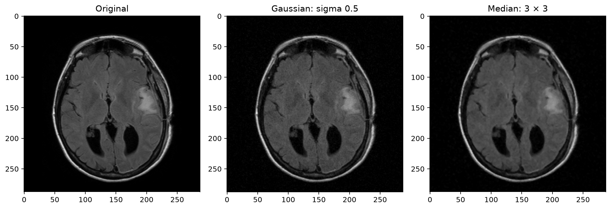
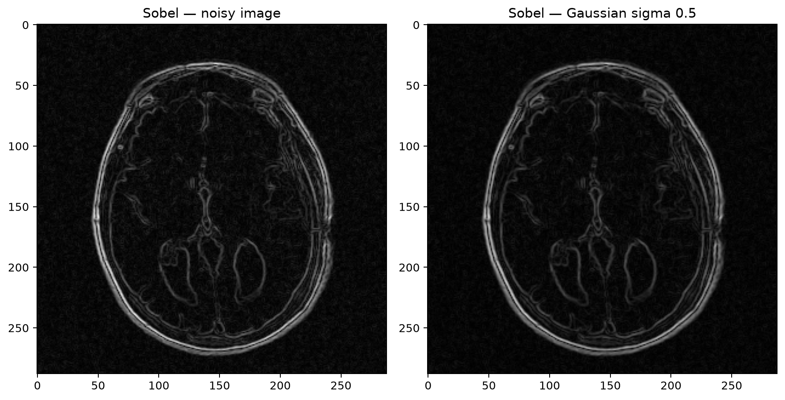
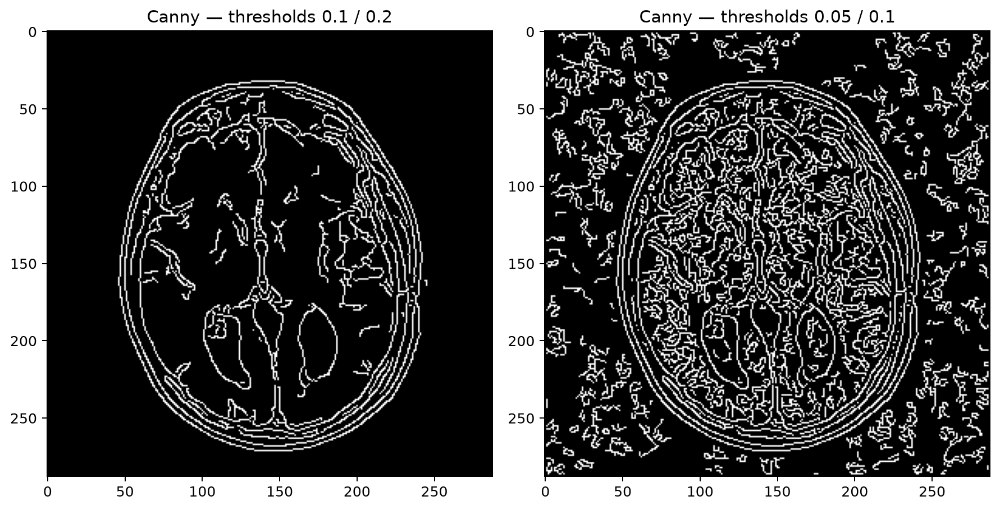
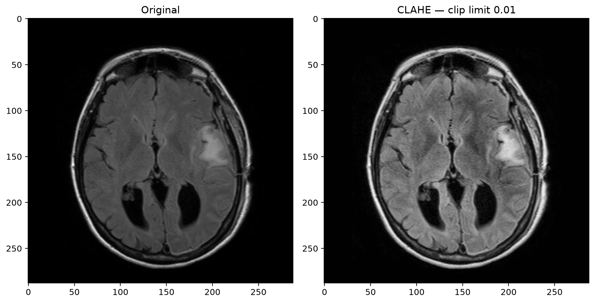

n filtering after adding reproducible
simulated noise. MSE, PSNR, and SSIM measure similarity to the original
acquisition. CLAHE enhances local contrast, while Sobel and Canny
highlight intensity boundaries.

## Workflow

1. Load and inspect a DICOM image.
2. Normalize its intensities to the range 0–1.
3. Add Gaussian noise using seed 42 and standard deviation 0.03.
4. Compare Gaussian filters with sigma 0.5 and 1.0 and a 3 × 3 median filter.
5. Calculate MSE, PSNR, and SSIM.
6. Compare Sobel and Canny edge maps.
7. Apply CLAHE with clip limit 0.01.
8. Save arrays, comparison figures, and metrics.
9. Record processing parameters and results in SQLite.

## Scope

The experiment uses file 012.dcm from a 22-file FLAIR series.
It selects the middle filename; anatomical slice ordering is not verified.

The original MRI already contains acquisition noise. It serves as
the reference before adding simulated noise.

This is a digital image processing experiment, not a trained AI model
or a clinically validated diagnostic tool.

## Denoising Results

Lower MSE and higher PSNR indicate closer pixel intensities to the
reference. Higher SSIM indicates greater local structural similarity.

| Image | MSE | PSNR (dB) | SSIM |
|---|---:|---:|---:|
| Noisy | 0.000906 | 30.43 | 0.6280 |
| Gaussian sigma 0.5 | 0.000431 | 33.66 | 0.7655 |
| Gaussian sigma 1.0 | 0.000678 | 31.69 | 0.8721 |
| Median 3 × 3 | 0.000435 | 33.62 | 0.8332 |

Gaussian sigma 0.5 achieved the lowest MSE and highest PSNR.
Gaussian sigma 1.0 achieved the highest SSIM but appeared blurrier.
The median filter nearly matched sigma 0.5 on pixel error and
achieved a higher SSIM.

These full-image measurements include the background. The findings
apply to this slice and simulated noise level; they do not establish
better diagnostic quality.

## Visual Comparisons

### Filtering



### Sobel Edges

Light Gaussian smoothing reduced background speckles while retaining
the main visible boundaries.



### Canny Edges

Lower thresholds detected more internal contours but also more
unwanted background edges.



### CLAHE Contrast Enhancement

CLAHE increased visible local contrast and also made existing
graininess more noticeable.




## Setup

Run these commands in PowerShell from the project folder:

```powershell
python -m venv .venv
.\.venv\Scripts\Activate.ps1
python -m pip install -r requirements.txt
```

## Input Data

Place the FLAIR DICOM files in:

```text
data/original/brain-mri/flair/
```

The original DICOM dataset is not included in this repository.
The demonstrated series contains 22 files named 001.dcm through 022.dcm.

The JPEG-LS decoder `pyjpegls` is required for this series.

## Run

With the virtual environment active:

```powershell
python src\inspect_dicom.py
python src\setup_database.py
python src\inspect_dicom.py
```

The script opens comparison plots and saves outputs in `outputs/`.
Close the plot windows to return to the terminal.

## Saved Outputs

- NumPy arrays preserve processing values.
- PNG files display images and comparisons.
- `filter_metrics.json` stores denoising metrics.
- `database/mri_processing.db` stores source image details and
  seven processing records.

The database must already contain the `images` and
`processing_results` tables before running the current script.

PSNR and SSIM are left empty for CLAHE and edge maps because
those outputs are not evaluated as denoising results.

Repeating the experiment overwrites the same output files and
updates matching database records.